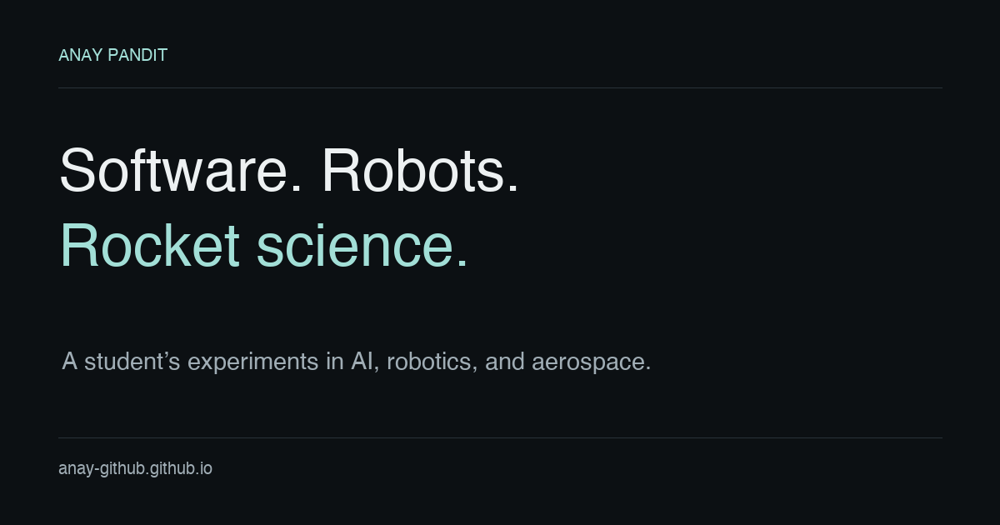

# Anay Pandit

**Student. Builder. Always curious.**

My personal portfolio, bringing together software, robotics, and aerospace projects—and the questions behind them.

**[Visit the website](https://anaypandit.github.io/)** · **[GitHub](https://github.com/anaypandit)** · **[LinkedIn](https://www.linkedin.com/in/anaypandit/)**

## Selected work

| Project | What it's about |
| --- | --- |
| [Rocket Flight Lab](https://anaypandit.github.io/projects/rocket-flight-lab/) | An interactive simulator for exploring thrust, gravity, changing mass, and drag. |
| [VEX Robotics](https://anaypandit.github.io/projects/vex-robotics/) | Building competition robots and helping teams grow, from Pinnacle View to ASMSA. |
| [MindBloom](https://anaypandit.github.io/projects/mindbloom/) | A team-built student wellness prototype with daily check-ins and supportive insights. |
| [Focus Coach](https://anaypandit.github.io/projects/focus-coach/) | A winning hackathon project exploring a gentler approach to focus and digital habits. |

## About me

I'm Anay, an ASMSA student interested in AI, robotics, and aerospace. I learn by building, testing ideas, and working with other people. Beyond the screen, my interests include aviation, RC planes, Civil Air Patrol, and golf.

The website shares project stories, team achievements, and what I'm exploring next.

## About this website

A custom portfolio built with **HTML, CSS, and JavaScript**, with **Codex assistance**. Project stories credit the teams and tools involved in each project.

[Sources and image credits](SOURCES.md)
