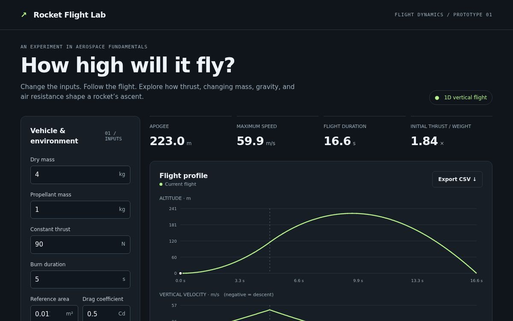

# Rocket Flight Lab

An educational rocket-flight simulator for exploring how thrust, changing mass, gravity, and drag affect a single-stage vertical flight.

Adjust the vehicle, run a flight, compare scenarios, and inspect the equations behind the result. The project is an early, AI-assisted prototype with numerical verification and explicit model limitations.



## Run it

Download the repository and open **index.html** in a browser. No installation, API key, or external JavaScript dependency is required.

Alternatively, serve the folder locally:

```sh
python3 -m http.server 8000
```

Then open `http://localhost:8000`.

## Explore

- Change dry mass, propellant mass, constant thrust, burn duration, reference area, and drag coefficient.
- Follow altitude and vertical velocity over time.
- Inspect engine cutoff, apogee, and the first ground crossing.
- Play or scrub through the flight.
- Pin one run and compare it with another.
- Export time-series data as CSV.

**A first experiment:** run the default case, pin it, turn atmospheric drag off, and run again. Keep the other inputs unchanged and compare the predicted apogee.

## Physics

The model integrates altitude and vertical velocity with fourth-order Runge–Kutta (RK4), using a 0.02-second time step. A step ends exactly at engine cutoff.

```text
m(t) = m_dry + m_prop × max(0, 1 − t / t_burn)
rho(h) = 1.225 × exp(−max(0, h) / 8500) kg/m³
dh/dt = v
dv/dt = (T − 0.5 × rho × Cd × A × v × |v|) / m − g
g = 9.80665 m/s²
```

Thrust and mass flow are constant during the burn. Drag opposes velocity in both directions. Pad contact prevents downward motion before liftoff. Apogee and ground-crossing events are interpolated between integration samples.

Background reference: [NASA Glenn — Ideal Rocket Equation](https://www1.grc.nasa.gov/beginners-guide-to-aeronautics/ideal-rocket-equation/).

## Verification

With Node.js installed, run:

```sh
node physics.test.cjs
```

The six checks displayed in the app cover:

1. Burnout velocity against the no-drag rocket equation with gravity loss.
2. Burnout altitude against the corresponding analytical solution.
3. No-drag apogee against a ballistic-coast calculation.
4. Apogee convergence when the time step is halved with drag enabled.
5. Zero thrust remaining on the pad.
6. Burnout mass equaling dry mass.

Additional regression assertions cover ground crossing, finite outputs, drag behavior, invalid inputs, delayed liftoff, and the simulation time limit.

For the illustrative default inputs, predicted apogee is approximately **222.984 m with drag** and **253.730 m without drag**. These are simulation results. Numerical checks do not establish accuracy against a real flight.

## Scope and limitations

The current model has one vertical axis and one stage, constant gravity, constant thrust and mass flow during the burn, an exponential atmosphere, and a fixed drag coefficient. It does not model wind, attitude, staging, orbital motion, parachutes, or trajectory optimization. Descent ends at the first ground crossing. The run is capped at 600 seconds or 100,000 samples.

There is no real-flight calibration, mission telemetry, proprietary vehicle data, or external engineering validation in this version. Extreme parameter combinations may be unsuitable for the simplified model and fixed time step. Default values are illustrative, not a proposed hardware configuration.

## Project ownership and assistance

**Project direction:** Anay Pandit, exploring aerospace engineering and simulation.

**Initial implementation:** the interface, physics implementation, and tests were generated with Codex on November 10, 2026. This repository preserves that assistance transparently. Further experiments, reviews, and improvements should be documented with their individual contributions.

## How the app was built

Anay chose a rocket simulator as the project direction. Codex generated a dependency-free HTML/CSS/JavaScript interface and a separate physics module. The model computes changing mass, thrust, gravity, and atmospheric drag, then advances altitude and velocity with RK4. The interface turns those samples into graphs, playback, scenario comparisons, and downloadable CSV data. Node.js tests compare the numerical output with analytical no-drag cases and check regression behavior.

Anay's aerospace research discussions with NG, a former ISRO professional associated with Omspace Rocket and Exploration, helped frame the broader interest in simulation. The current educational prototype has not been commissioned, calibrated, or validated by Omspace. It does not yet implement the broader proposed trajectory-optimization research.

## Awards

No cash prize or competition placement has been documented for Rocket Flight Lab as of November 10, 2026. Focus Coach and MindBloom are separate projects with their own hackathon awards.

## Development directions

- Document controlled parameter comparisons and the questions they answer.
- Examine the effect of model assumptions and numerical choices.
- Seek a qualified review of the equations and implementation.
- Compare an appropriately scoped model with openly documented flight measurements when suitable data is available.

## Files

| File | Purpose |
|---|---|
| `index.html` | Interface and styles |
| `app.js` | Controls, graphs, playback, and CSV export |
| `physics.js` | Numerical model and verification cases |
| `physics.test.cjs` | Node.js regression tests |
| `preview.png` | Interface screenshot |
